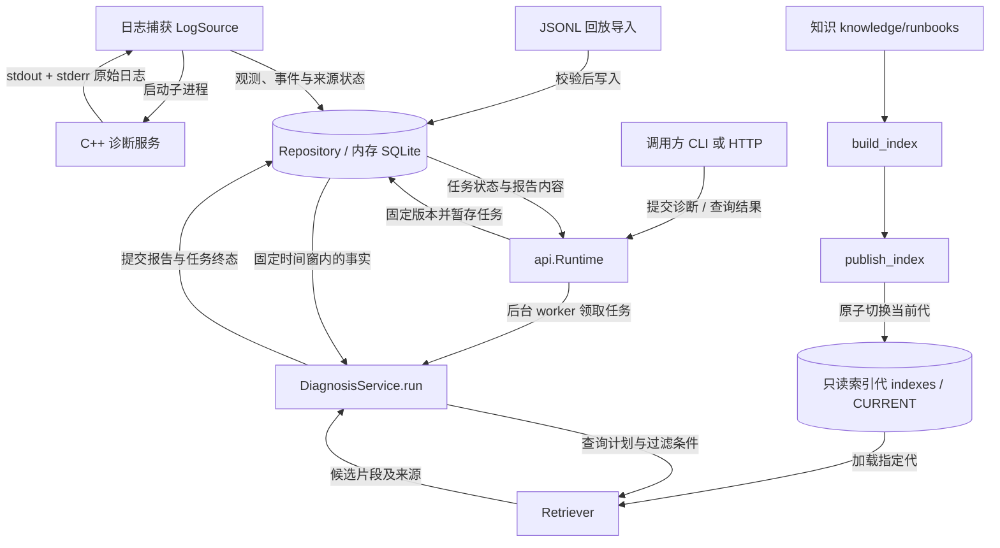

# 网络诊断 RAG

`netdiag-rag` 从网络诊断日志提取事实，检索排障知识，再由 DashScope 大模型生成附有证据、引用和检查建议的报告；默认使用 BM25 检索，必须配置 DashScope API Key，可选 BGE 编码、重排和 Jev 决策。

- 观测数值由程序计算并附带单位；诊断模型只作定性解释，须通过引用和因果校验。
- 检查建议来自已审核知识，参数绑定到当前可信范围，检查不会自动执行。
- 日志、任务和报告仅存于本次进程内存；知识、索引、模型缓存和撤回记录继续保存。

[使用方式](#一使用方式) · [项目架构](#二项目架构) · [代码结构](#三代码结构) · [实现机制](#四实现机制) · [维护与测试](#五维护与测试)

## 一、使用方式

### 1. 安装环境

要求 Linux、Python 3.11–3.13；GPU 模式还需要可用的 NVIDIA 驱动与 CUDA 环境。
以下命令除特别说明外均在本仓库 `rag/` 目录运行，`--config` 放在子命令之前。

```bash
# 尚未安装 uv 时执行；已安装则跳过前两行
curl -LsSf https://astral.sh/uv/install.sh | sh
export PATH="$HOME/.local/bin:$PATH"
cd /home/codex/924/AI-powered-Network-Diagnostics/rag
uv --version
uv sync --frozen
uv run netdiag-rag --config configs/default.yaml doctor
```

`doctor` 检查依赖、目录、日志程序和凭据状态，不加载模型或发送模型请求。

### 2. 大模型 RAG 回放演示

终端 A：输入 DashScope API Key，校验 16 条知识、构建并发布索引，然后导入内置 WiFi 案例。

```bash
read -rsp 'DashScope API Key: ' DASHSCOPE_API_KEY; printf '\n'; export DASHSCOPE_API_KEY
uv run netdiag-rag --config configs/default.yaml knowledge validate
uv run netdiag-rag --config configs/default.yaml index build --label initial --as-of 2026-09-23T16:55:40Z
uv run netdiag-rag --config configs/default.yaml index publish --label initial
uv run netdiag-rag --config configs/default.yaml serve --replay datasets/fixtures/wifi_weak_signal.jsonl --replay-id wifi-demo --jev off
```

终端 B：进入同一 `rag/` 目录，提交配套请求并等待结果。

```bash
uv run netdiag-rag diagnose --request datasets/fixtures/wifi_weak_signal.request.json --wait
```

请求已指定 `replay:wifi-demo`、案例时间窗和知识截止时间；更换回放 ID 时需同步修改请求。
演示数据是合成案例，用于检查流程；报告不会把主机级 TCP 重传比解释成接口丢包率。

### 3. 完整功能流程：GPU、实时日志与生成

`configs/gpu-quality.yaml` 启用 BGE-M3、BM25/向量融合、BGE 重排和 DashScope `qwen-plus`。
本地编码与重排使用下载的权重；DashScope 需要自己的 API Key，Jev 由启动时的选择决定。

终端 A：准备依赖、日志程序、模型和索引后启动服务；`dbus-run-session` 供 C++ 使用会话总线，Python 从 stdout/stderr 获取日志。

```bash
uv sync --frozen --extra models
uv run --frozen --extra models python -c 'import torch; print("CUDA available:", torch.cuda.is_available())'
make -C ../server ENABLE_BPF=0
sudo setcap cap_net_raw+ep ../server/bin/weaknet-dbus-server
read -rsp 'DashScope API Key: ' DASHSCOPE_API_KEY; printf '\n'; export DASHSCOPE_API_KEY
uv run --frozen --extra models netdiag-rag --config configs/gpu-quality.yaml models download
uv run --frozen --extra models netdiag-rag --config configs/gpu-quality.yaml doctor
uv run --frozen --extra models netdiag-rag --config configs/gpu-quality.yaml knowledge validate
uv run --frozen --extra models netdiag-rag --config configs/gpu-quality.yaml index build --label full-rag
uv run --frozen --extra models netdiag-rag --config configs/gpu-quality.yaml index publish --label full-rag
dbus-run-session -- uv run --frozen --extra models netdiag-rag --config configs/gpu-quality.yaml serve --source logs
```

CUDA 检查应返回 `True`；首次下载需要联网。`setcap` 为实时 ICMP 探测授权，重新编译后需重新设置。
启动时选择 `y` 开启 Jev，缺少 TypeSafe 凭据时再隐藏输入；回车或 `n` 关闭，无需 TypeSafe Key。
也可使用 `--jev on` 或 `--jev off`；非交互启动选 `on` 时需预先配置凭据。

终端 B：进入 `rag/`，检查索引就绪和日志采集状态，再等待约 65 秒积累一分钟数据。

```bash
uv run --frozen --extra models netdiag-rag --config configs/gpu-quality.yaml capabilities
ip -brief link
```

确认 `index_ready: true`、`actual_retrieval_mode: hybrid`，以及 `source_health.logs.status: capturing`、`parsed_lines > 0`。
从接口列表选择实际待诊断接口；以下命令自动读取采集主机 ID，生成临时请求并提交。

```bash
read -rp '待诊断接口（如 wlan0）: ' NETDIAG_INTERFACE
NETDIAG_REQUEST_FILE="$(mktemp)"
uv run --frozen --extra models python - "$NETDIAG_INTERFACE" "$NETDIAG_REQUEST_FILE" <<'PY'
import sys
from pathlib import Path
import httpx
from netdiag_rag.contracts import DiagnosisRequest
cap = httpx.get("http://127.0.0.1:8091/v1/capabilities").raise_for_status().json()
request = DiagnosisRequest(host_id=cap["source_health"]["logs"]["host_id"],
                           interfaces=[sys.argv[1]], question="最近一分钟网络有什么异常，优先检查什么？")
Path(sys.argv[2]).write_text(request.model_dump_json(), encoding="utf-8")
PY
uv run --frozen --extra models netdiag-rag --config configs/gpu-quality.yaml diagnose --request "$NETDIAG_REQUEST_FILE" --wait
rm -- "$NETDIAG_REQUEST_FILE"
```

本次模型执行情况见 `diagnostics.retrieval`、`diagnostics.decisions`、`report.usage.generation_validated`。
任务成功表示大模型输出已通过校验；`report.degradations` 记录检索、Jev 或输出修正情况，生成失败不会返回纯事实报告。
在终端 A 按 `Ctrl+C` 停止服务，日志子进程和模型进程一并关闭，本次日志及报告清除。

CPU 全链路可复制 GPU 配置，把两个模型的 `device` 改为 `cpu`、编码器 `dtype` 改为 `float32`，设置独立 `data_dir` 并调整超时。

### 4. 配置、凭据与请求

| 配置文件 | 用途 |
|---|---|
| `default.yaml` | 默认 BM25 检索与 DashScope 生成 |
| `cpu-baseline.yaml` | CPU BGE 与 BM25 混合检索、DashScope 生成 |
| `gpu-quality.yaml` | GPU 混合检索、重排、DashScope、实时日志 |
| `real-model-validation.yaml` | 完整模型链路检查，禁止向纯 BM25 检索降级 |
| `jev-fixture.yaml` | 模拟 Jev 协议，生成仍调用 DashScope，仍需 Key |
| `jev-validation.yaml` | BM25、真实 Jev 与 DashScope 联调，需两种 Key |

配置路径相对于配置文件解析；各档案使用独立数据目录，构建、发布与启动必须选同一档案。
模型档案固定 40 位 `revision`，默认只读本地权重；更换编码模型或分块配置后需重建索引。

| 能力 | 启用条件 | 凭据 |
|---|---|---|
| BGE 编码 | `embedding.provider: bge` | 本地权重，无 API Key |
| 重排 | `reranker.enabled: true` | 本地权重，无 API Key |
| DashScope 生成 | 必选，`generation.provider` 仅允许 `dashscope` | `DASHSCOPE_API_KEY` 或 `DASHSCOPE_API_KEY_FILE` |
| Jev 两项决策 | `serve --jev on` | `TYPESAFE_API_KEY` 或 `TYPESAFE_API_KEY_FILE` |


### 5. HTTP 与命令入口

服务默认监听 `http://127.0.0.1:8091`，通过 CLI 或 HTTP 使用，`/docs` 提供接口调试。

| 接口 | 用途 |
|---|---|
| `POST /v1/diagnoses` | 提交任务，返回 `202` 和 `job_id`；支持 `Idempotency-Key` |
| `GET /v1/diagnoses/{job_id}` | 查询本次会话的状态、诊断轨迹与报告 |
| `POST /v1/diagnoses/{job_id}/cancel` | 请求取消，在后续预算检查点退出 |
| `GET /v1/reports/{report_id}` | 读取报告并标记当前已撤回的引用 |
| `GET /health/live`、`GET /health/ready` | 存活与索引、生成凭据、磁盘就绪检查 |
| `GET /v1/capabilities`、`GET /v1/metrics` | 配置能力、采集状态与运行指标 |
| `POST /v1/admin/indexes/publish` | 在线发布，传 `label` 或 `generation_id` |
| `POST /v1/admin/knowledge/revoke` | 撤回知识，传 `key` |


`diagnose` 支持 `--wait`、`--wait-timeout`、`--idempotency-key`、`--url`；完整参数用 `netdiag-rag <子命令> --help` 查看。

## 二、项目架构

服务采用单机单实例架构：FastAPI 受理请求，后台 worker 执行诊断，计算与同步模型调用在工作线程运行。
`LogSource` 启动本仓库 `server/bin/weaknet-dbus-server`，通过独立管道读取 stdout/stderr；自定义路径用 `--server-executable`。
日志解析结果、任务和报告由内存 `Repository` 持有，知识索引由 `Retriever` 按代加载并复用。



采集持续写入当前会话；每次诊断固定事实修订、接收截止时间、知识截止点和索引代，后续数据不改变该任务的输入范围。
索引构建与发布分离，在线发布先预热再原子切换；新任务使用新代，已受理任务继续使用固定的原代。
后台维护清理过期数据与无引用旧索引；关闭过程受统一截止时间限制，必要时终止模型进程。

| 数据 | 保存位置与生命周期 |
|---|---|
| 日志、观测、事件 | 内存 SQLite，按分析窗口清理；进行中的任务保留所需输入 |
| 任务、报告、诊断轨迹 | 内存中保留最近 64 个已完成任务及报告，退出清除 |
| 知识撤回记录 | `<data_dir>/knowledge.sqlite`，重启后继续生效 |
| 知识与索引 | `knowledge/runbooks/`、`<data_dir>/indexes/generations/` |
| 向量缓存与模型权重 | `indexes/embedding-cache.sqlite` 与模型下载缓存，跨运行复用 |

同一 `data_dir` 由 `owner.lock` 文件锁保护，HTTP worker 固定为 1；内存数据库单连接由锁保护。
知识撤回在诊断执行和报告提交时检查，执行期间撤回版本变化会阻止提交旧依据的报告。

## 三、代码结构

命令入口在 `pyproject.toml` 注册为 `netdiag-rag = netdiag_rag.cli:main`。

```text
rag/
├── pyproject.toml / uv.lock       # 包配置、依赖锁定
├── configs/ / schemas/           # 运行档案与导出的 JSON Schema
├── knowledge/                    # 16 条审核知识、领域词典与知识格式说明
├── datasets/                     # 8 个合成案例及 manifests/fixtures.json
├── scripts/generate_fixtures.py  # 合成数据生成
├── src/netdiag_rag/              # 服务实现，职责见下表
└── tests/test_api_integration.py # 唯一主测试程序
```

| 代码入口 | 职责 |
|---|---|
| [cli.py](src/netdiag_rag/cli.py)、[startup.py](src/netdiag_rag/startup.py)、[settings.py](src/netdiag_rag/settings.py) | 命令、配置、Jev 选择和凭据输入 |
| [api.py](src/netdiag_rag/api.py)、[lifecycle.py](src/netdiag_rag/lifecycle.py) | HTTP、任务调度、索引切换与进程关闭 |
| [contracts](src/netdiag_rag/contracts/__init__.py)、[telemetry](src/netdiag_rag/telemetry/__init__.py)、[storage](src/netdiag_rag/storage/__init__.py) | 数据契约、日志捕获、回放与内存状态 |
| [evidence](src/netdiag_rag/evidence/__init__.py)、[query.py](src/netdiag_rag/query.py) | 事实统计、规则、趋势与查询规划 |
| [knowledge](src/netdiag_rag/knowledge/loader.py)、[indexing](src/netdiag_rag/indexing/snapshots.py)、[retrieval](src/netdiag_rag/retrieval/core.py) | 知识校验、分块、索引、召回、重排与上下文 |
| [decisions](src/netdiag_rag/decisions/__init__.py)、[diagnosis](src/netdiag_rag/diagnosis/__init__.py) | 适用性判断、检查选择、报告编排与生成校验 |
| [providers](src/netdiag_rag/providers/embedding.py)、[privacy.py](src/netdiag_rag/privacy.py)、[util.py](src/netdiag_rag/util.py) | 模型适配、受控子进程、脱敏与公共工具 |
| [maintenance.py](src/netdiag_rag/maintenance.py)、[observability.py](src/netdiag_rag/observability.py)、[evaluation](src/netdiag_rag/evaluation/__init__.py) | 磁盘检查、运行日志与手动评测 |

阅读主链：`Runtime.submit → worker → DiagnosisService.run → EvidenceBuilder → QueryPlanner → Retriever → 决策与生成 → Repository.commit_report`。

## 四、实现机制

### 1. 事实与日志

结构化 `NETDIAG_TELEMETRY {JSON}` 日志按 C++ 采样时间划分窗口，Python 接收时间用于控制迟到数据。
普通 `RTT_MONITOR`、`RSSI_MONITOR`、`TCP_LOSS_MONITOR` 等文本只提取已有数值，使用捕获时间，覆盖率标记为未知。
无效哨兵值、失败与缺测单独保留；`ACTIVE/INACTIVE` 摘要不用于确认接口链路状态。
`EvidenceBuilder` 按主机、接口、路径、采集会话等作用域分组，计算分位数、计数器增量、速率和 RSSI 趋势。
`acquisition_coverage` 表示记录采集覆盖率，`evidence.coverage` 表示有效指标覆盖率；不适用或明确未启用的可选指标不算缺测，实际采集失败仍会告警。
日志原文保存在 `evidence_bundle.events[].details.raw`，事实通过 `event_ids` 追溯；超长行跳过解析，身份冲突批次隔离后继续采集。

### 2. 检索与上下文

查询规划把问题、症状与观测范围组成一至两个查询变体，并使用任务共享的 `Redactor` 脱敏主机、地址等标识。
知识先按审核、撤回、时间和适用范围硬过滤；接口类型、协议与症状作偏好过滤，命中不足时扩展许可范围。
BM25 计算词项分数并用堆选择 Top-K；FAISS 在全量索引搜索内过滤许可行；多路结果经 RRF 融合，可再用 BGE 重排。
相同分数按片段 ID 稳定排序；邻居扩展复用父块到子块的映射，每个已选父块最多补一个合法相邻片段。
上下文合并同父块片段、去除重叠正文，并保留适用条件、反证、限制和全部引用来源。
预算按渲染内容的 UTF-8 字节数保守估算，并非模型真实 token 数；普通模式保留完整条目，`all_context` 超限则明确报错。
生成输入还需预留输出和修正消息空间；裁剪知识后重新生成合法检查集合，避免引用已移出的候选。

### 3. 决策、生成与校验

Jev 可判断片段适用性，并从本次合法检查集合选择下一项；本地保护逻辑保留已确认原因和重要反证。
`build_checks` 汇总审核定义、排除冲突与不适用项，统一推导可信接口和目标，再逐项绑定及校验参数。
`check_context` 只补充检查参数；缺少参数、跨接口目标或不合法定义会被拒绝，并记录原因。
DashScope 接收脱敏事实和知识，返回受限 JSON；诊断原因、反证和告警不得填写数值，程序校验引用、原因归属、缺失项与结论条件。
直接确认的原因目前包括接口链路断开和采集权限不足；其余原因保持假设，并列出后续检查。
观测陈述始终由程序生成；模型选择的检查须再次校验 ID、引用和参数，随后回填可信用途、目标与参数。
输出不合法时可在共享调用预算内要求修正；仍失败则任务失败且不产生报告，已移除 `generation.provider: none` 与 `allow_facts_only`。

### 4. 性能与一致性

- 查询缓存按实际可用知识集合复用，每次仍检查时间有效性和撤回；稳定降级可缓存，单次推理失败产生的降级不缓存。
- 构建向量缓存对相同输入只查库一次；返回矩阵负责隔离，避免重复逐行复制。
- 在线模型子进程常驻，按批次推理并复用缓存；超时可终止实际推理，GPU 文件锁协调并发。
- 上下文预算增量计算，父块邻居映射按快照复用；父块正文仅在加载时校验，不常驻运行快照。
- 同一任务复用脱敏映射、已确认原因和每种输出模式的 Schema；回放解析与摘要使用同一次文件读取。
- 幂等哈希在补默认窗口前计算；同键同载荷重用首次任务，显式窗口不同视为不同载荷。
- 总超时包含排队时间，过期任务在加载模型前退出；终态为成功、失败、取消或超时。

## 五、维护与测试

知识更新在 `knowledge/runbooks/` 完成，格式见 [knowledge/README.md](knowledge/README.md)；修改后执行：

```bash
uv run netdiag-rag --config configs/default.yaml knowledge validate
uv run netdiag-rag --config configs/default.yaml index build --label updated
uv run netdiag-rag --config configs/default.yaml index publish --label updated
```

在线服务运行时，最后一步改用 `index publish --label updated --online`，两端配置相同 `NETDIAG_ADMIN_TOKEN`。
当前诊断通常省略 `--as-of`；严格历史回放需保留对应知识修订，并确保请求截止点不早于索引截止点。
`index gc --dry-run` 预览旧代清理，`index recover` 恢复可用当前代；模型档案使用其自己的配置与数据目录。

| 现象 | 排查入口 |
|---|---|
| `uv` 找不到 | 按安装步骤补装并检查 `$HOME/.local/bin` 是否在 `PATH` |
| 没有知识引用或检索为空 | 检查索引发布、审核状态、时间范围、适用条件与撤回状态 |
| 启动提示缺 Key 或生成失败 | 配置 DashScope Key；看 `doctor`、任务 `error` 与 `diagnostics.generation`，生成失败不会返回报告 |
| 实时日志为空 | 检查可执行文件、采集权限和 `source_health.logs` 的状态、解析计数、退出码 |
| `all_context_budget_exceeded` | 增加预算或缩小完整文档范围 |
| 锁被占用或磁盘阻止启动 | 检查已有实例、`data_dir` 和磁盘空间；锁文件保留，由进程释放锁 |

主测试通过模拟 HTTP 响应覆盖模型适配器与输出校验，不调用外部服务；以下命令仍在 `rag/` 执行。

```bash
.venv/bin/pytest -q tests/test_api_integration.py
# 包含本仓库 C++ 程序的日志接入测试
make -C ../server ENABLE_BPF=0
dbus-run-session -- env NETDIAG_RUN_CPP_LOG_TEST=1 .venv/bin/pytest -q tests/test_api_integration.py
```

`models verify --output FILE` 可检查真实 BGE 与重排器；`evaluate --output DIR --suite smoke|retrieval|pipeline|decisions` 为手动检查入口。
这些命令显式保存检查产物；所有诊断评测均调用大模型，需 Key 和 `--allow-model-calls`，合成案例通过不代表真实诊断质量。
报告版本为 v2，主要字段有 `evidence_bundle`、`citations`、`next_checks`、`retrieval_trace`、`provenance` 和 `degradations`。
修改数据契约后用 `schemas --output DIR` 重新导出；报告摘要可追溯版本，但不能恢复退出后已清除的日志。
